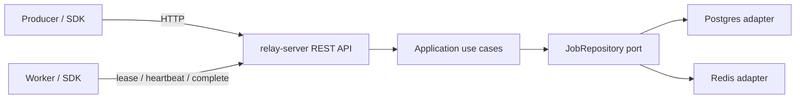

# Relay

[](https://github.com/MEHRDADsmj/relay/actions/workflows/ci.yml)
[](https://goreportcard.com/report/github.com/MEHRDADsmj/relay)
[](LICENSE)
[](https://go.dev/)

**Relay** is a durable, distributed job queue in Go. Producers enqueue jobs over HTTP;
workers built with the Relay SDK lease jobs, execute them, heartbeat while running, and
report success or failure. Storage is pluggable: **PostgreSQL** and **Redis** implement
the same port and pass the same contract tests.

## Architecture



Dependencies point inward (Clean Architecture). The composition root in `cmd/relay-server`
wires config, storage, and HTTP. See [docs/adr](docs/adr/) for design decisions.

## Features and roadmap

| Phase | Status | Highlights |
|---|---|---|
| **1 — Core** | Done | Domain + app ports, Postgres & Redis adapters, OpenAPI REST API, `relay-server`, Go SDK, examples, Docker Compose, CI |
| [2 — Reliability](docs/plan/phase-2.md) | Done | Exponential backoff, attempt history, reaper/retention, cancel/retry, queue pause, long-poll wakeups |
| [3 — Platform](docs/plan/phase-3.md) | Planned | Cron, gRPC, API keys, `relayctl` |
| [4 — Ops](docs/plan/phase-4.md) | Planned | Prometheus, OpenTelemetry, Helm, GoReleaser |
| [5 — Polish](docs/plan/phase-5.md) | Planned | Dashboard, load tests |

Plans: [phase-1](docs/plan/phase-1.md), [phase-2](docs/plan/phase-2.md).

## Quickstart

Requires only **Docker** (Compose v2). No Make needed for this path.

```bash
# Start Postgres, Redis, relay-server, and two example workers
docker compose up -d --build --scale example-worker=2

# Enqueue a batch of demo jobs (producer profile)
docker compose --profile demo run --rm --no-deps example-producer

# Or enqueue manually
curl -sS -X POST http://localhost:7420/v1/jobs \
  -H 'Content-Type: application/json' \
  -d '{"queue":"default","type":"send_welcome_email","payload":{"user_id":"u1","email":"u1@example.com"}}'

curl -sS http://localhost:7420/readyz
curl -sS http://localhost:7420/v1/jobs/<job-id>

docker compose down -v
```

Redis backend instead of Postgres:

```bash
RELAY_STORAGE=redis docker compose up -d --build --scale example-worker=2
```

Optional Make shortcuts (same stack): `make up`, `make demo`, `make up-redis`, `make down`.

Host ports avoid common clashes: API `7420`, Postgres `54329`, Redis `63799`.

## Local development

**Requirements:** Go (see `go.mod`), Docker, `golangci-lint` v2, Make (Git Bash on Windows).

```bash
make deps          # Postgres + Redis only
cp .env.example .env
make lint
make test
make build
./bin/relay-server serve   # or: go run ./cmd/relay-server serve
```

Useful targets: `make test-integration`, `make test-e2e`, `make generate`,
`make check-generated`, `make cover`.

In GoLand / VS Code, run `cmd/relay-server` with env from `.env.example` after `make deps`.
Set `RELAY_MIGRATE_ON_START=true` on first Postgres run, or run migrations manually:
`relay-server migrate up` (also `migrate status`, `migrate down`).

## HTTP API

| Method | Path | Purpose |
|---|---|---|
| `POST` | `/v1/jobs` | Enqueue (`201` new; `200` + `Idempotent-Replayed: true` on replay) |
| `GET` | `/v1/jobs/{id}` | Get job |
| `GET` | `/v1/jobs/{id}/attempts` | Attempt history |
| `POST` | `/v1/queues/{queue}/leases` | Lease up to `max_jobs` (optional `wait_seconds` long-poll) |
| `POST` | `/v1/jobs/{id}/heartbeat` | Extend lease (response may include `cancel_requested`) |
| `POST` | `/v1/jobs/{id}/complete` | Mark succeeded |
| `POST` | `/v1/jobs/{id}/fail` | Report failure (retry, dead, or `permanent: true`) |
| `POST` | `/v1/jobs/{id}/release` | Voluntary lease return |
| `POST` | `/v1/jobs/{id}/cancel` | Cancel pending or request cancel while running |
| `POST` | `/v1/jobs/{id}/retry` | Re-queue dead or cancelled |
| `GET` | `/v1/queues` | List queues |
| `GET` | `/v1/queues/{queue}` | Queue stats |
| `POST` | `/v1/queues/{queue}/pause` | Pause claims |
| `POST` | `/v1/queues/{queue}/resume` | Resume claims |
| `GET` | `/v1/queues/{queue}/jobs` | Paginated list by status |
| `POST` | `/v1/queues/{queue}/dead/retry` | Bulk retry dead letters |
| `GET` | `/healthz` | Liveness |
| `GET` | `/readyz` | Readiness (storage ping) |

Full contract: [api/openapi.yaml](api/openapi.yaml). Errors use RFC 9457
`application/problem+json`. Optional auth: set `RELAY_API_KEY` and send
`Authorization: Bearer <key>` (health endpoints exempt).

## SDK example

```go
package main

import (
	"context"
	"log"

	"github.com/MEHRDADsmj/relay/pkg/sdk"
)

func main() {
	ctx := context.Background()
	client := sdk.NewClient("http://localhost:7420")

	job, err := client.Enqueue(ctx, sdk.EnqueueRequest{
		Queue:   "default",
		Type:    "send_welcome_email",
		Payload: map[string]string{"user_id": "u1", "email": "u1@example.com"},
	})
	if err != nil {
		log.Fatal(err)
	}
	_ = job

	w, err := sdk.NewWorker(client, sdk.WorkerOptions{Queue: "default", Concurrency: 10})
	if err != nil {
		log.Fatal(err)
	}
	sdk.Handle(w, "send_welcome_email", func(ctx context.Context, job sdk.Job[map[string]string]) error {
		// process job.Args — must be idempotent
		return nil
	})
	log.Fatal(w.Run(ctx))
}
```

See `examples/producer` and `examples/worker` for a full demo.

## Delivery guarantees

Relay delivers jobs **at least once**. Workers hold an exclusive lease, heartbeat to keep
it, then complete or fail. Crashes and expired leases can cause **re-execution**. Handlers
must be idempotent. Producers can pass an idempotency key on enqueue to safely retry
creates. Exactly-once execution is out of scope (see [ADR 0003](docs/adr/0003-at-least-once-delivery-with-leases.md)).

Additional Phase 2 semantics:

- **Release** — on graceful shutdown the SDK returns in-flight leases to `pending` without
  burning an attempt, so another worker can pick them up immediately.
- **Cancel** — pending jobs become `cancelled` at once; running jobs get
  `cancel_requested` and resolve to `cancelled` when the worker next completes or fails
  (cooperative; see [ADR 0010](docs/adr/0010-cancellation-semantics.md)).
- **Permanent errors** — `sdk.Permanent(err)` / fail with `permanent: true` marks the job
  `dead` after that attempt (no retry schedule).
- **Retries** — default policy is exponential full jitter ([ADR 0007](docs/adr/0007-exponential-backoff-full-jitter.md));
  dead or cancelled jobs can be retried (attempts reset to 0).
- **Long-poll** — lease wait uses push wakeups as hints only; Claim remains the source of
  truth ([ADR 0008](docs/adr/0008-push-wakeups-are-hints.md)).

## Operating Relay

- **Retention** — the maintenance runner purges terminal jobs older than `RELAY_RETENTION`
  (default 7 days; `0` = never). Reaper reclaim of expired leases runs on every instance
  (`RELAY_REAP_*`). See [ADR 0009](docs/adr/0009-attempt-history-and-retention.md).
- **Pause / resume** — `POST /v1/queues/{queue}/pause` stops new claims (leases return
  empty); resume restores them. Useful for deploys or incident freezes.
- **Dead-letter replay** — inspect via `GET /v1/queues/{queue}/jobs?status=dead`, retry one
  job with `POST /v1/jobs/{id}/retry`, or bulk with `POST /v1/queues/{queue}/dead/retry`.
- **Attempts** — `GET /v1/jobs/{id}/attempts` shows per-claim outcomes for forensics.
- **Stats** — `GET /v1/queues/{queue}` returns counts including scheduled and oldest pending age.

## Design decisions

Architecture Decision Records live in [docs/adr/](docs/adr/):

1. [Clean Architecture](docs/adr/0001-clean-architecture.md)
2. [Pluggable Postgres and Redis storage](docs/adr/0002-pluggable-storage-postgres-and-redis.md)
3. [At-least-once delivery with leases](docs/adr/0003-at-least-once-delivery-with-leases.md)
4. [Spec-first OpenAPI](docs/adr/0004-spec-first-openapi.md)
5. [Time injected from the application layer](docs/adr/0005-time-injected-from-application-layer.md)
6. [Redis single-node and durability](docs/adr/0006-redis-single-node-and-durability.md)
7. [Exponential backoff with full jitter](docs/adr/0007-exponential-backoff-full-jitter.md)
8. [Push wakeups are hints](docs/adr/0008-push-wakeups-are-hints.md)
9. [Attempt history and retention](docs/adr/0009-attempt-history-and-retention.md)
10. [Cancellation semantics](docs/adr/0010-cancellation-semantics.md)

## Testing

| Layer | How |
|---|---|
| Unit | `make test` (`-race`); domain/app/SDK/HTTP with fakes |
| Contract | Shared `storagetest` suite against memory, Postgres, Redis |
| Integration | `make test-integration` (`-tags=integration`, Testcontainers) |
| E2E | `make test-e2e` (`-tags=e2e`); full stack, both backends |
| Generated | `make check-generated` — sqlc + oapi-codegen must be clean |
| Lint / vulns | `make lint`; CI runs `govulncheck` |

## Configuration

Copy [`.env.example`](.env.example). Notable vars: `RELAY_STORAGE`, `RELAY_POSTGRES_URL`,
`RELAY_REDIS_URL`, `RELAY_HTTP_ADDR`, `RELAY_API_KEY`, `RELAY_MIGRATE_ON_START`,
`RELAY_RETRY_POLICY` / `RELAY_RETRY_BASE` / `RELAY_RETRY_MAX`, `RELAY_REAP_*`,
`RELAY_PURGE_*`, `RELAY_RETENTION`, `RELAY_LEASE_MAX_WAIT`.

## License

[MIT](LICENSE)
