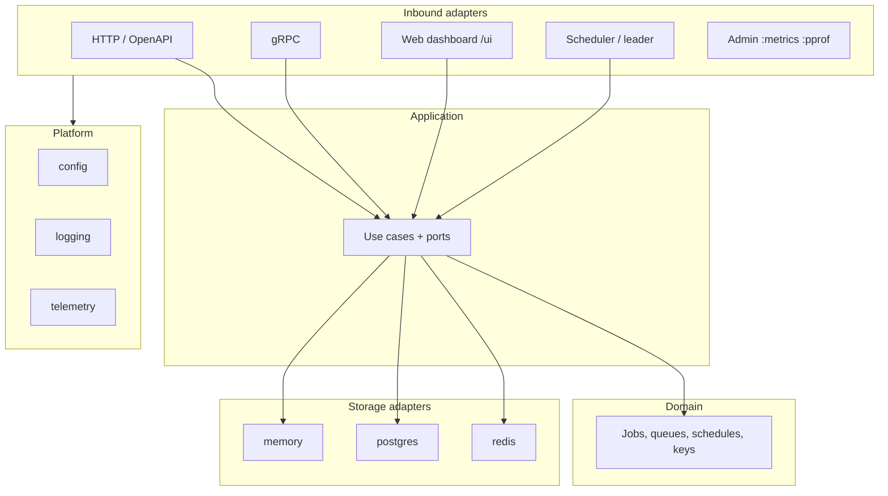
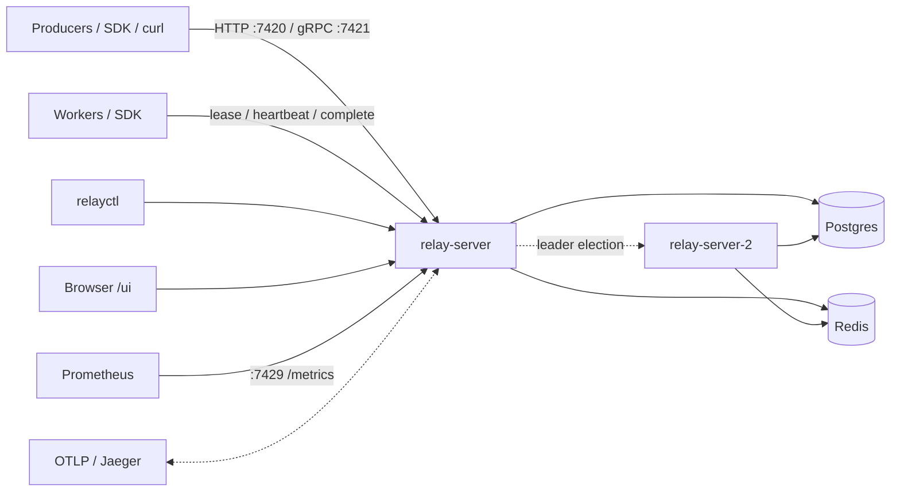

# Relay architecture

Relay is a durable job queue built as a Clean Architecture Go service. Dependencies point
**inward**: adapters call application use cases; use cases depend on ports; the domain
stays free of infrastructure. See [ADR 0001](adr/0001-clean-architecture.md).

## Layer diagram

## Package map

| Path | Role |
|---|---|
| `internal/domain` | Entities and pure rules (stdlib + `uuid`) |
| `internal/app` | Use cases, ports, fakes for unit tests |
| `internal/adapter/http` | REST handlers (generated types from OpenAPI) |
| `internal/adapter/grpc` | gRPC services |
| `internal/adapter/web` | Server-rendered dashboard (templ + HTMX) |
| `internal/adapter/storage/{memory,postgres,redis}` | Storage backends + `storagetest` contracts |
| `internal/adapter/cron` | Leader-elected schedule ticks |
| `internal/adapter/metrics` | Prometheus collectors |
| `internal/adapter/admin` | Private admin mux |
| `internal/platform/{config,logging,telemetry}` | Cross-cutting wiring helpers |
| `cmd/relay-server` | Composition root |
| `cmd/relayctl` | Operator CLI |
| `cmd/relay-bench` | Throughput / latency harness |
| `pkg/sdk` | Public Go client + worker (HTTP or gRPC) |
| `api/openapi.yaml` | HTTP contract (spec-first) |
| `proto/relay/v1` | gRPC contract |

`depguard` in `golangci-lint` enforces layer boundaries in CI.

## Runtime topology

Compose runs two server instances so scheduler failover is visible. Storage backend is
selected with `RELAY_STORAGE=postgres|redis` ([ADR 0002](adr/0002-pluggable-storage-postgres-and-redis.md)).

## Request lifecycles

### Enqueue

1. Client `POST /v1/jobs` (or gRPC `Enqueue`) with queue, type, payload, optional
   idempotency key and delay.
2. HTTP/gRPC adapter authenticates (API key scopes), maps DTO → domain, calls
   `JobService.Enqueue`.
3. Storage inserts the job (`pending` or `scheduled`), bumps minutely `enqueued` stats,
   returns the job. Idempotent replay returns the original job with
   `Idempotent-Replayed: true`.

### Lease long-poll

1. Worker `POST /v1/queues/{queue}/leases` with `max_jobs` and optional `wait_seconds`.
2. `Claim` selects claimable rows/keys under a lease ([ADR 0003](adr/0003-at-least-once-delivery-with-leases.md)).
3. If empty and wait > 0, the server waits for a **push wakeup hint** or timeout; Claim
   remains the source of truth ([ADR 0008](adr/0008-push-wakeups-are-hints.md)).
4. Worker heartbeats while running; complete / fail / release / cancel as appropriate.

### Failure → retry → dead

1. Worker reports `Fail` (or crashes; reaper expires the lease).
2. App applies retry policy (default exponential full jitter,
   [ADR 0007](adr/0007-exponential-backoff-full-jitter.md)): schedule next `run_at`, or mark
   `dead` when attempts are exhausted / `permanent: true`.
3. Attempt history is retained for forensics ([ADR 0009](adr/0009-attempt-history-and-retention.md)).
4. Operators retry via API, `relayctl`, or the dashboard (“Retry all dead”).

### Cron fire with failover

1. Cluster elects a scheduler leader ([ADR 0012](adr/0012-leader-election-and-idempotent-fires.md)).
2. Leader ticks due schedules; misfire policy catches up at most one missed fire
   ([ADR 0011](adr/0011-cron-misfire-policy.md)).
3. Enqueue uses idempotency key `schedule:{id}:{fire_unix}` so failover cannot double-fire
   the same tick.

## Storage data models (side by side)

| Concern | Postgres | Redis |
|---|---|---|
| Job record | `jobs` table (sqlc) | Hash `relay:job:{id}` + secondary indexes |
| Claim | CTE claim with `FOR UPDATE SKIP LOCKED` + partial indexes ([ADR 0022](adr/0022-postgres-claim-partial-indexes.md)) | Lua script: atomic ZSET/LIST claim |
| Attempts | `job_attempts` rows | List/hash per job |
| Queue pause | `queues` row / flag | Key `relay:queue:{name}:paused` |
| Schedules | `schedules` table | Hash + due ZSET |
| Leader | Advisory / lease row | SET NX PX lease key |
| Throughput stats | `queue_stats_minutely` upsert | `HINCRBY` `relay:stats:{queue}:{minute}` + TTL |
| Schedule→jobs | Idempotency prefix scan | ZSET `relay:schedule:{id}:jobs` (cap 100) |
| Durability | WAL / managed Postgres | AOF recommended; single-node caveats ([ADR 0006](adr/0006-redis-single-node-and-durability.md)) |

Both adapters pass the same `storagetest` contract suite.

## Dashboard

Server-rendered UI at `/ui/` ([ADR 0019](adr/0019-server-rendered-dashboard-templ-htmx.md)):
session auth ([ADR 0021](adr/0021-dashboard-session-security.md)), minutely stats without
Prometheus ([ADR 0020](adr/0020-dashboard-stats-without-prometheus.md)), SSE live fragments.

## Further reading

- [ADR index](adr/README.md)
- [Benchmarks](benchmarks.md)
- [Ops runbook](runbook.md)
- Phase plans: [1](plan/phase-1.md) … [5](plan/phase-5.md)
